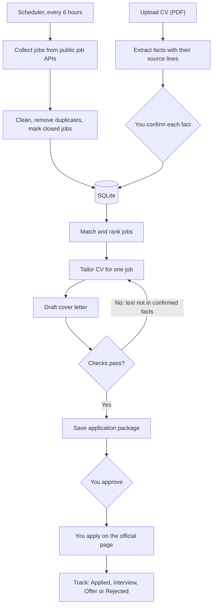
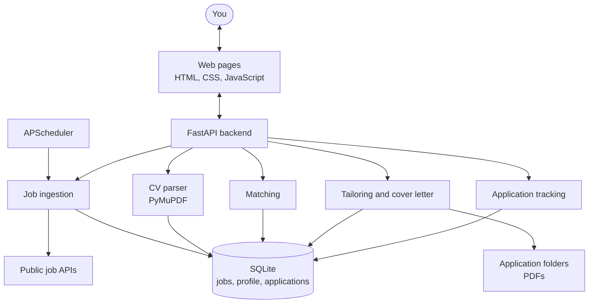

# CareerPilot AI

CareerPilot runs the job search from start to finish on your own computer. It collects jobs, compares them with your CV, prepares a tailored CV and cover letter, and tracks each application.

It never invents anything. Every line in a tailored CV or cover letter comes from a CV fact you confirmed, and nothing is submitted for you. You approve each application and apply on the company's official page.

The full plan is in [docs/plan-architecture.md](docs/plan-architecture.md).

## How it works



1. **Find jobs.** A scheduler pulls jobs every 6 hours from Greenhouse, Lever and Ashby job boards and from Remotive and Arbeitnow. Jobs are cleaned into one format, duplicates are merged, and jobs that disappear from their source are marked closed. You can also fetch now from the Jobs page.
2. **Build your profile.** You upload your CV as a PDF. Contact details, education, skills, projects and experience are extracted, and each fact keeps the exact line it came from. Two-column layouts, sidebars and bold project titles are supported. You confirm, edit or reject each fact.
3. **Match.** Each job's required and preferred skills are read from its description and compared with your confirmed facts. A skill used in a project counts more than one that is only listed. Each score comes with the skills you have, the skills you are missing, and the CV line behind each match.
4. **Tailor.** For a chosen job, your most relevant projects and skills move to the top. Skills the job asks for that you cannot show are reported and never added. A check confirms every line matches a confirmed fact before the PDF can be downloaded.
5. **Prepare the application.** A cover letter is drafted from the same facts. You can edit it, but a letter that names a skill you cannot show is blocked. The CV, letter and a copy of the job posting are saved in one folder for that job.
6. **Review, apply and track.** You approve the package, open the official page and apply yourself. Then you update the status. A follow-up reminder is set 7 days after you apply.

## Architecture



| Part | Where | What it does |
|---|---|---|
| Web pages | `app/static/` | Home, Jobs, Matches, CV Studio, Tailored CV and Applications pages |
| Backend | `app/server.py` | JSON API and page routes, available only on this computer |
| Job ingestion | `services/job_sources.py`, `services/job_ingest.py`, `services/scheduler.py` | Source adapters, cleaning, duplicate removal, scheduled refresh |
| CV parser | `services/resume_parser.py` | Reading order, sections, entries and source evidence for each fact |
| Matching | `services/matching.py`, `config/skills.yaml` | Skill extraction from jobs and an explainable score |
| Tailoring | `services/tailoring.py`, `services/application_package.py` | Reordered CV, cover letter, checks and PDFs |
| Tracking | `services/applications.py` | Allowed status changes, approval rule and reminders |
| Storage | `database/` | SQLite tables for jobs, profile facts and applications |

## Rules the code enforces

- Only facts you confirmed are used in matching, tailoring and letters.
- A tailored CV with any line that is not in a confirmed fact cannot be downloaded or saved.
- An application cannot be marked applied until you approve it.
- Changing a package after approval needs a new approval. A package you applied with cannot be replaced.
- Your CV, database and application folders stay in `data/`, which git ignores.

## Not built yet

- Rewriting CV bullets with a language model. Tailoring reorders your text but does not reword it.
- Answers to application form questions.
- MCP tools and an agent workflow (Phase 6).
- Scoring weights are first estimates and have not been checked against hand-labelled jobs.

## Setup

```
python -m venv .venv
.venv\Scripts\python -m pip install -r requirements.txt
```

## Run

```
.venv\Scripts\python -m app.server
```

Then open http://127.0.0.1:8000. While the server runs, the scheduler fetches new jobs every 6 hours.

Sources and the interval are in `config/sources.yaml`. Keywords are set on the Jobs page. To keep data somewhere other than `data/`, set `CAREERPILOT_DATA_DIR` as shown in `.env.example`.

## Test

```
.venv\Scripts\python -m pytest
```

Tests use synthetic CVs, so no real CV is needed.
