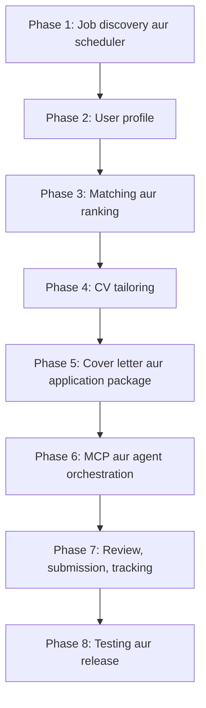
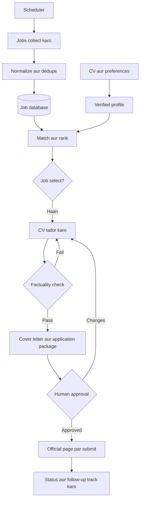
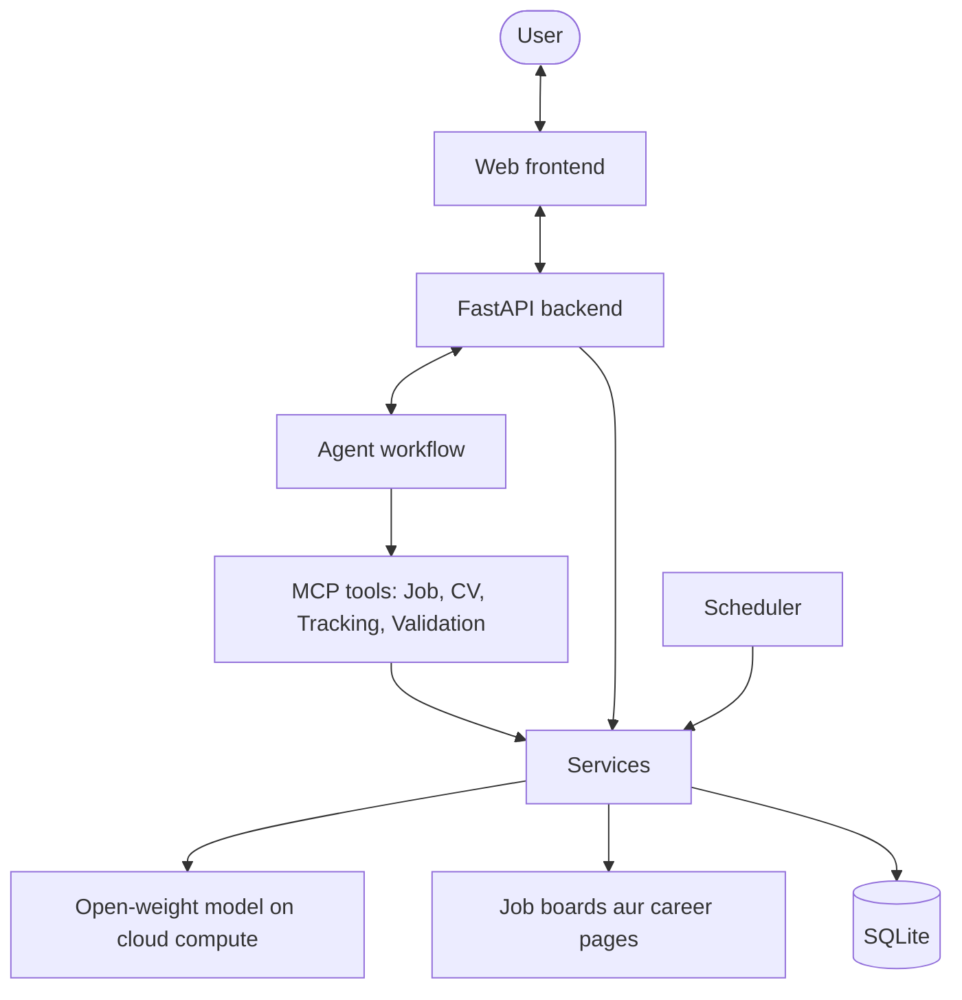
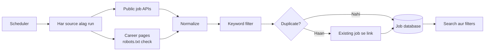
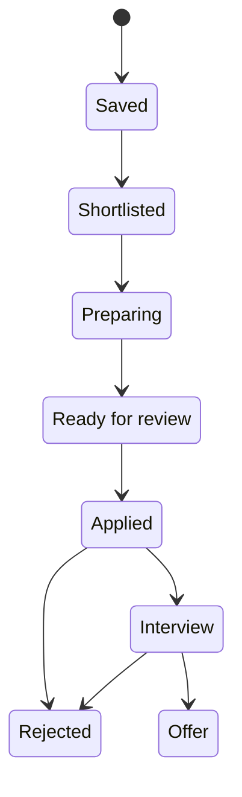

# CareerPilot AI — Plan aur Architecture

CareerPilot ek AI agent hai jo job discovery se lekar CV tailoring, application preparation aur tracking tak poora workflow manage karta hai.

**Constraints:** 8 GB RAM, sirf cloud GPU, zero paid LLM API.

**Stack:** Python, FastAPI, HTML/CSS/JavaScript, MCP, open-weight LLM, SQLite.

**Rules**

- CV mein fake experience, fabricated metrics, ya unused technologies add nahi hongi.
- Har skill CV ke source evidence se trace hogi.
- Human approval ke baghair koi application submit nahi hogi.
- LinkedIn scraping aur auto-apply sirf official permission se.

## Build order



## Product workflow



## Architecture



## Phases

### Phase 1 — Job discovery aur scheduler (Week 1)

Scheduler har 6 ghante mein sources check karta hai, aur nayi jobs database mein aati rehti hain.



- Sources: Greenhouse, Lever, Ashby, Remotive, Arbeitnow, aur company career pages.
- Ek source fail ho to baqi chalte rahein, aur har run log ho.
- Jo job source se hat jaye wo closed mark ho.

**Deliverable:** background mein update hota searchable job database.

### Phase 2 — User profile (Week 2)

CV PDF parse karna, education, skills, experience, projects aur certifications nikalna, aur preferences save karna. Har fact ka source quote verify hoga.

**Deliverable:** verified candidate profile in SQLite.

### Phase 3 — Matching aur ranking (Week 2–3)

Job ki required skills ko CV evidence se compare karna, missing skills batana, aur explainable match score calculate karna.

**Deliverable:** ranked shortlist, explanations ke saath.

### Phase 4 — CV tailoring (Week 3)

Relevant projects prioritize karna, bullets rewrite karna, unsupported claims reject karna, aur original vs tailored diff dikhana.

**Abhi tak:** projects aur skills ka order job ke hisaab se, change report, unsupported check, aur PDF download ban gaye hain. Bullets ki rewriting baqi hai, kyun ke us ke liye LLM chahiye.

**Deliverable:** job-specific CV aur change report.

### Phase 5 — Cover letter aur application package (Week 3–4)

Cover letter, question answers, consistency check, document checklist, aur har application ka alag folder.

**Abhi tak:** confirmed facts se cover letter, checklist, consistency check aur har job ka folder ban gaye hain. Question answers baqi hain, kyun ke application forms ke sawal abhi system mein nahi aate.

**Deliverable:** review-ready application package.

### Phase 6 — MCP aur agent orchestration (Week 4–5)

Services ko Job, CV, Tracking aur Validation MCP tools mein expose karna, aur workflow LangGraph se chalana.

**Deliverable:** end-to-end tool-using agent.

### Phase 7 — Review, submission, tracking (Week 5)

Final package review, approval, official page par submission, aur status tracking.

**Abhi tak:** Applications board asli data par chal raha hai. System khud kuch submit nahi karta, aur approval ke bina koi application Applied nahi ban sakti.



### Phase 8 — Testing aur release (Week 6)

Tests, job-match evaluation, failure logging, privacy, README, demo video, aur local-first release.

**Deliverable:** GitHub par documented AI agent.

## Project structure

```text
CareerPilot-AI/
├── app/            FastAPI server aur frontend
├── agent/          Workflow aur planner
├── mcp_servers/    MCP tools
├── services/       Scraping, scheduler, parsing, matching
├── models/         Schemas aur inference
├── database/       Schema aur repository
├── config/         Sources aur schedule
├── tests/
├── docs/
└── data/           Git-ignored
```
